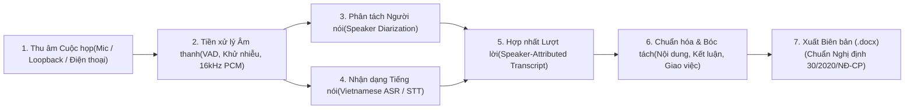

# Nghiên Cứu Hệ Thống Ghi Âm Cuộc Họp & Tự Động Hóa Lập Biên Bản Cuộc Họp

Thư mục này lưu trữ hồ sơ nghiên cứu kỹ thuật, kiến trúc xử lý âm thanh - ngôn ngữ tự nhiên (Audio DSP $\rightarrow$ ASR/Speech-to-Text $\rightarrow$ Speaker Diarization $\rightarrow$ LLM Structuring) và công cụ tự động xuất bản **Biên bản cuộc họp (.docx)** theo thể thức văn bản hành chính quy định tại **Nghị định số 30/2020/NĐ-CP**.

---

## 1. Cấu Trúc Thư Mục Nghiên Cứu

```text
Nghien_Cuu_Ghi_Am_Cuoc_Hop/
├── README.md                                                        # Tổng quan kiến trúc & Ma trận giải pháp kỹ thuật
├── docs/
│   ├── 01_Kien_Truc_Thu_Am_Phong_Hop_Va_Truc_Tuyen.md               # Kỹ thuật thu âm phòng họp (Beamforming, AEC) & Họp trực tuyến (WASAPI)
│   ├── 02_Cong_Nghe_STT_Tieng_Viet_Va_Speaker_Diarization.md        # Mô hình nhận dạng tiếng nói tiếng Việt (PhoWhisper, Whisper-v3) & Phân tách người nói
│   ├── 03_Quy_Trinh_NLP_Trich_Xuat_Va_Lap_Bien_Ban_Hanh_Chinh.md    # Pipeline bóc tách nội dung, kết luận, bảng giao việc & Chuẩn hóa NĐ 30/2020/NĐ-CP
│   └── 04_Bao_Mat_Am_Thanh_OnPremise_Va_Phap_Ly.md                  # Giải pháp xử lý Offline (On-Premise) bảo mật nội bộ & Tuân thủ pháp lý
├── prototypes/
│   ├── meeting_recorder.py                                          # Công cụ thu âm cuộc họp đa kênh (Mic phòng họp + System Loopback)
│   ├── transcribe_and_diarize.py                                    # Công cụ gỡ băng tiếng Việt kèm dấu thời gian & nhận diện người phát biểu
│   └── export_meeting_minutes_docx.py                               # Engine xuất Biên bản cuộc họp (.docx) chuẩn Nghị định 30/2020/NĐ-CP
├── recordings/                                                      # Thư mục lưu trữ tệp âm thanh gốc (.wav, .m4a, .mp3)
├── transcripts/                                                     # Thư mục lưu trữ văn bản gỡ băng thô (.json, .txt, .srt)
└── output_minutes/                                                  # Thư mục lưu trữ Biên bản cuộc họp hoàn chỉnh (.docx)
```

---

## 2. Kiến Trúc Luồng Xử Lý Toàn Trình (End-to-End Pipeline)



---

## 3. Ma Trận Đánh Giá Các Công Nghệ Lõi Cho Tiếng Việt

### 3.1. Mô hình Chuyển Giọng Nói Thành Văn Bản (ASR / Speech-to-Text Tiếng Việt)

| Mô hình / Giải pháp | Chế độ vận hành | Độ chính xác tiếng Việt (WER) | Khả năng xử lý từ viết tắt / chuyên ngành | Yêu cầu phần cứng | Đánh giá áp dụng |
| :--- | :---: | :---: | :---: | :--- | :--- |
| **1. PhoWhisper (VinAI - Medium/Large)** | Offline (Local) | Cao (Tối ưu riêng cho âm vị và phương ngữ Bắc - Trung - Nam) | Tốt khi kết hợp Initial Prompt | GPU $\ge$ 6GB VRAM hoặc CPU (qua CTranslate2/GGML) | Phù hợp cho hệ thống On-Premise bảo mật dữ liệu nội bộ. |
| **2. Faster-Whisper (Large-v3 / Turbo)** | Offline (Local) | Cao (Đa ngôn ngữ, hỗ trợ tốt tiếng Việt pha thuật ngữ tiếng Anh) | Rất tốt (Hỗ trợ `initial_prompt` và `hotwords`) | GPU $\ge$ 4GB VRAM hoặc CPU 8 nhân (INT8 quantization) | Tốc độ xử lý nhanh gấp 4 lần Whisper gốc, tiêu chuẩn cho cuộc họp kỹ thuật song ngữ. |
| **3. Sherpa-ONNX (Zipformer Vietnamese)** | Offline (Mobile / Edge) | Khá - Cao | Trung bình | Chạy trực tiếp trên điện thoại Android/iOS (RAM < 500MB) | Phù hợp tích hợp trực tiếp vào ứng dụng di động ghi âm cuộc họp tại hiện trường. |
| **4. Gemini Multimodal Audio / Cloud ASR** | Cloud API | Rất cao (Hiểu ngữ cảnh sâu, tự phân biệt người nói) | Rất cao (Nạp trực tiếp từ điển chuyên ngành vào Prompt) | Không yêu cầu phần cứng cục bộ | Phù hợp cho các cuộc họp không chứa thông tin mật, xử lý nhanh file ghi âm dài 1-3 giờ. |

### 3.2. Giải pháp Phân Tách Người Phát Biểu (Speaker Diarization)

| Phương pháp | Nguyên lý kỹ thuật | Ưu điểm | Hạn chế |
| :--- | :--- | :--- | :--- |
| **1. Đa kênh phần cứng (Multi-Channel Audio)** | Tách kênh độc lập: Kênh Trái (Mic người chủ trì) / Kênh Phải (Âm thanh hệ thống hoặc Mic hội trường). | Phân tách chính xác 100% giữa người dùng cục bộ và đầu cầu trực tuyến mà không tốn tài nguyên AI. | Không tách riêng được nhiều người cùng ngồi chung một microphone đơn. |
| **2. Pyannote.audio 3.1 + Silero VAD** | Trích xuất vector đặc trưng giọng nói (Speaker Embeddings / ECAPA-TDNN) và phân cụm theo dấu thời gian. | Tự động gán nhãn `SPEAKER_00`, `SPEAKER_01`... cho nhiều người trong cùng một phòng họp. | Cần đối chiếu thủ công hoặc dùng mẫu giọng (Voiceprint Enrollment) để đổi `SPEAKER_00` thành tên thật. |
| **3. Đa phương thức theo Ngữ cảnh (Audio + LLM Diarization)** | Kết hợp đặc trưng âm học với phân tích xưng hô trong câu thoại (ví dụ: *"Mời anh Nam báo cáo..."*). | Tự động suy luận chức danh và họ tên người phát biểu từ ngữ cảnh điều hành của chủ tọa. | Phụ thuộc vào việc chủ tọa có giới thiệu tên người phát biểu trong cuộc họp hay không. |

---

## 4. Quy Chuẩn Thể Thức Biên Bản Cuộc Họp Đầu Ra (Nghị định 30/2020/NĐ-CP)

Mọi tệp Biên bản cuộc họp (`.docx`) xuất ra từ hệ thống tuân thủ các quy định định dạng hành chính:
1. **Phông chữ & Màu sắc**: Sử dụng phông chữ `Times New Roman`, màu chữ đen (`#000000`) trên toàn bộ văn bản và bảng biểu.
2. **Quốc hiệu & Tiêu ngữ**: Trình bày bằng bảng 2 cột ẩn khung viền (`No Border`) ở đầu trang để cố định vị trí đối xứng giữa tên cơ quan/đơn vị và Quốc hiệu.
3. **Cấu trúc nội dung biên bản**:
   - Thời gian, địa điểm, hình thức họp (trực tiếp / trực tuyến).
   - Thành phần tham dự (Chủ trì, Thư ký, Thành viên tham dự, Khách mời).
   - Nội dung cuộc họp: Báo cáo trung thực theo trình tự phát biểu và thảo luận của từng đại biểu (tôn trọng dữ liệu gốc từ băng ghi âm, không tự ý suy diễn nội dung ngoài băng ghi âm).
   - Kết luận của Chủ trì cuộc họp và Bảng phân công nhiệm vụ (nền trắng, kẻ viền đen mảnh `0.5pt`, lặp lại dòng tiêu đề khi sang trang).
   - Chữ ký xác nhận của Thư ký và Chủ trì cuộc họp.
