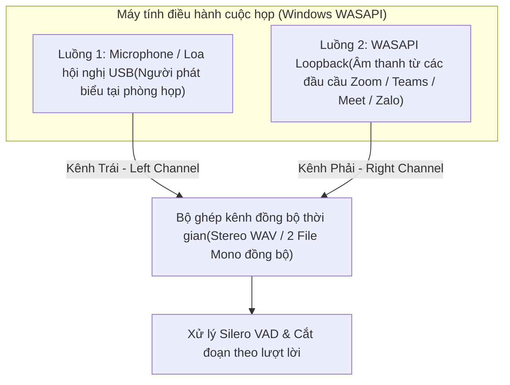

# 01. Kiến Trúc Thu Âm Phòng Họp Trực Tiếp & Họp Trực Tuyến Đa Kênh

Tài liệu này phân tích các phương án thu thập tín hiệu âm thanh đầu vào cho hệ thống tạo biên bản cuộc họp tự động, bao gồm hai kịch bản chính: **Họp trực tiếp tại phòng họp (In-person Meeting)** và **Họp trực tuyến / Kết hợp (Online / Hybrid Meeting)**.

---

## 1. Yêu Cầu Kỹ Thuật Đối Với Tín Hiệu Âm Thanh Cho Nhận Dạng Tiếng Nói (ASR)

Chất lượng văn bản gỡ băng (Speech-to-Text) phụ thuộc trực tiếp vào tỷ lệ tín hiệu trên nhiễu (SNR - Signal-to-Noise Ratio) và độ trễ dội âm (RT60 - Reverberation Time) của tệp ghi âm:

- **Tần số lấy mẫu chuẩn (Sample Rate)**: `16,000 Hz` (16 kHz) là tần số chuẩn đầu vào của hầu hết các mô hình ASR hiện đại (Whisper, PhoWhisper, Wav2Vec2, Zipformer). Việc thu âm ở `44.1 kHz` hoặc `48 kHz` sau đó hạ mẫu (downsample) bằng bộ lọc chống răng cưa (Anti-aliasing filter) về `16 kHz` giúp giữ nguyên dải tần giọng nói con người (85 Hz – 8,000 Hz) đồng thời giảm dung lượng lưu trữ.
- **Độ sâu bit & Kênh (Bit Depth & Channels)**:
  - Lưu trữ xử lý AI: `16-bit PCM WAV`, Mono (hoặc Stereo tách kênh khi cần phân biệt nguồn âm).
  - Lưu trữ归đ档 (Archival): `AAC (.m4a)` hoặc `Opus (.ogg)` ở mức bitrate `64 kbps – 128 kbps` (tiết kiệm 85% dung lượng đĩa so với WAV không nén mà không làm giảm độ chính xác nhận dạng).

---

## 2. Kịch Bản 1: Thu Âm Tại Phòng Họp Trực Tiếp (In-Person Room Audio)

### 2.1. Thách thức âm học trong phòng họp
1. **Khoảng cách xa (Far-field Speech)**: Người phát biểu ngồi cách microphone từ 1.5m đến 5m làm suy hao biên độ âm thanh theo bình phương khoảng cách.
2. **Tiếng vang phòng họp (Room Reverberation)**: Tường kính, mặt bàn gỗ cứng phản xạ âm thanh gây hiện tượng chồng lấp âm tiết (smearing), làm mô hình STT nhận diện sai dấu thanh tiếng Việt.
3. **Nói chồng lấp (Overlapping Speech)**: Nhiều thành viên thảo luận cùng lúc khiến thuật toán phân tách người nói (Speaker Diarization) bị nhiễu.

### 2.2. Giải pháp phần cứng thu âm theo quy mô phòng họp

| Quy mô phòng họp | Giải pháp thiết bị thu âm | Cơ chế kỹ thuật | Phạm vi thu tối ưu |
| :--- | :--- | :--- | :--- |
| **Nhóm nhỏ (2 – 5 người)** | Điện thoại di động (Android/iOS) hoặc Máy ghi âm bỏ túi đặt giữa bàn | Sử dụng cụm Mic tích hợp, bật chế độ *Interview / Meeting Mode* (Beamforming 2 hướng hoặc đa hướng). | Bán kính 1.0m – 1.5m |
| **Phòng họp vừa (6 – 12 người)** | Loa hội nghị tích hợp Mic đa hướng (USB/Bluetooth Speakerphone: Jabra Speak, Anker PowerConf, Poly Sync) | Mảng 4–6 Microphone MEMS kết hợp DSP tích hợp khử tiếng vang (AEC), tự động cân bằng âm lượng (AGC - Automatic Gain Control) cho người ngồi xa. | Bán kính 2.5m – 3.5m (360 độ) |
| **Hội trường / Phòng họp lớn (> 15 người)** | Hệ thống âm thanh hội thảo cổ ngỗng (Chairman & Delegate Microphones) hoặc Mixer bàn | Lấy tín hiệu trực tiếp từ ngõ **LINE OUT / REC OUT** của bộ điều khiển trung tâm (Central Control Unit) qua USB Audio Interface vào máy tính. | Không giới hạn khoảng cách (Thu cận âm Close-talk cho từng đại biểu) |

---

## 3. Kịch Bản 2: Thu Âm Cuộc Họp Trực Tuyến & Hybrid (Zoom, MS Teams, Google Meet, Zalo PC)

Khi họp trực tuyến hoặc họp kết hợp (Hybrid), nếu dùng microphone ngoài thu âm thanh phát ra từ loa máy tính sẽ gặp hiện tượng suy giảm chất lượng và lọt tạp âm môi trường. Giải pháp chuẩn là **Thu âm số trực tiếp 2 luồng độc lập (Dual-Stream Digital Capture)** qua tầng `WASAPI` trên Windows:

### Lợi ích của kiến trúc tách 2 kênh độc lập:
1. **Không bị mất âm thanh khi đeo tai nghe**: Luồng `WASAPI Loopback` bắt trực tiếp gói âm thanh PCM tại Audio Render Endpoint của Windows trước khi ra tai nghe/loa.
2. **Tách biệt hoàn toàn Phòng họp trung tâm và Đầu cầu từ xa**: Kênh Trái luôn là tiếng của phòng họp cục bộ, Kênh Phải luôn là tiếng của các điểm cầu trực tuyến, loại bỏ hiện tượng nhầm lẫn người nói giữa hai đầu.

---

## 4. Chuỗi Tiền Xử Lý Tín Hiệu Số (Audio Pre-Processing Pipeline)

Trước khi đưa tệp âm thanh vào mô hình nhận dạng tiếng nói, hệ thống áp dụng 4 bước tiền xử lý:
1. **High-Pass Filter (80 Hz)**: Loại bỏ nhiễu tần số thấp (tiếng ù của máy điều hòa, quạt thông gió, tiếng rung mặt bàn).
2. **Chuẩn hóa độ lớn âm thanh (Loudness Normalization - EBU R128)**: Đưa mức âm lượng trung bình về `-16 LUFS` để các phát biểu nhỏ từ cuối phòng họp không bị mô hình STT bỏ qua.
3. **Phát hiện khoảng lặng và tiếng nói (Voice Activity Detection - Silero VAD)**:
   - Tự động cắt bỏ các khoảng im lặng kéo dài (ví dụ: thời gian nghỉ giải lao, thời gian đọc tài liệu) để ngăn chặn hiện tượng "ảo giác lặp từ" (Hallucination Loop) của mô hình Whisper trên các đoạn âm thanh trắng.
   - Chia tệp âm thanh dài (2–3 giờ) thành các phân đoạn ngắn (15–30 giây) đúng tại điểm ngắt câu tự nhiên.
